# Lumix Lux for Android

Copy photos and videos off a Panasonic Lumix over Wi-Fi, browse them, and shoot remotely. Talks to the camera directly, no
PC needed: gallery by day, search/filter/sort, zoomable viewer with EXIF details, background saving with a notification
(resume/cancel), remote shooting (live view, shutter, zoom, video), optional GPS tagging, and auto-finding the camera. Android 10+.

Supported cameras: Lumix ZS100 / TZ100 today; more are on the way (see
[lumix-lux-core](https://github.com/CameronChambers93/lumix-lux-core), `docs/REDESIGN.md`). The camera serves one app at a
time, so close other Lumix apps (or the [PC web app](https://github.com/CameronChambers93/lumix-lux-windows)) first.

## Screenshots

<p align="center">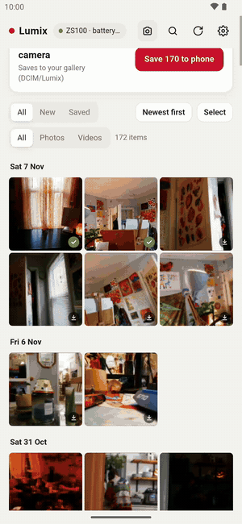<br>
<sub>With a real ZS100 (33 s). <a href="docs/media/demo.mp4">MP4 version</a>.</sub></p>

| | Light | Dark |
|---|---|---|
| **Gallery**: day groups, filters, save banner | 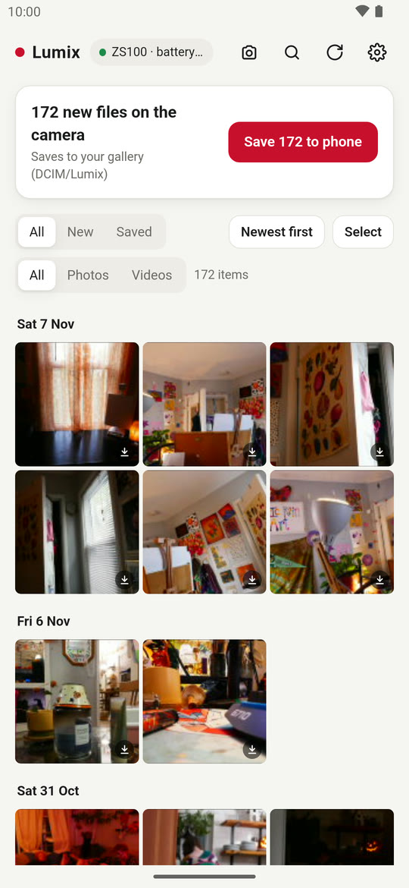 | 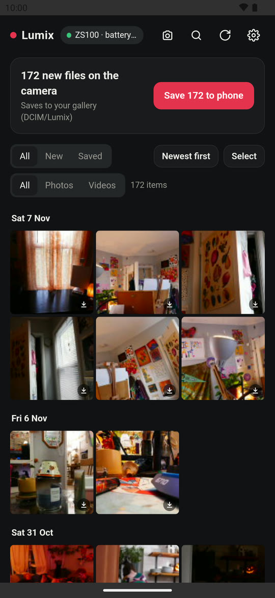 |
| **Viewer**: pinch/double-tap zoom, Full size, save | 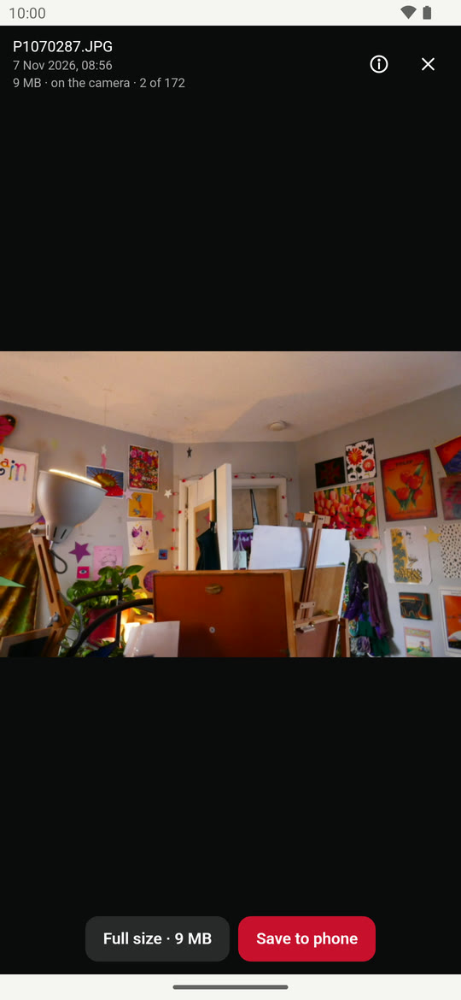 | 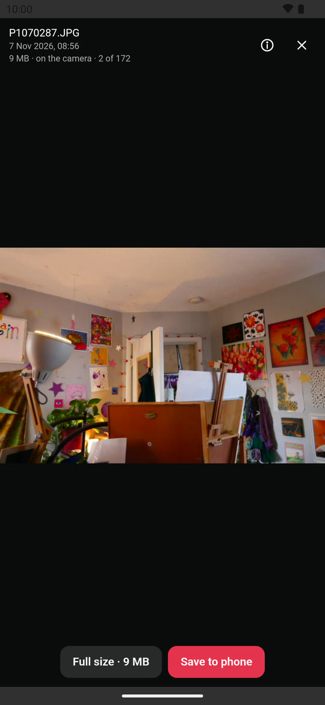 |
| **Details**: EXIF read from the camera or the saved file | 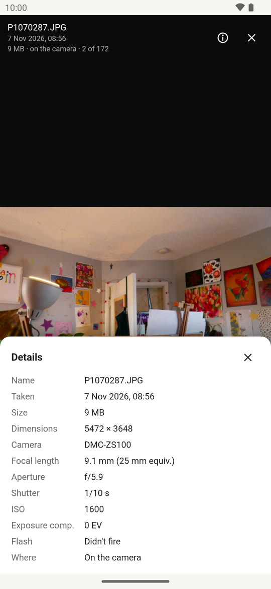 | 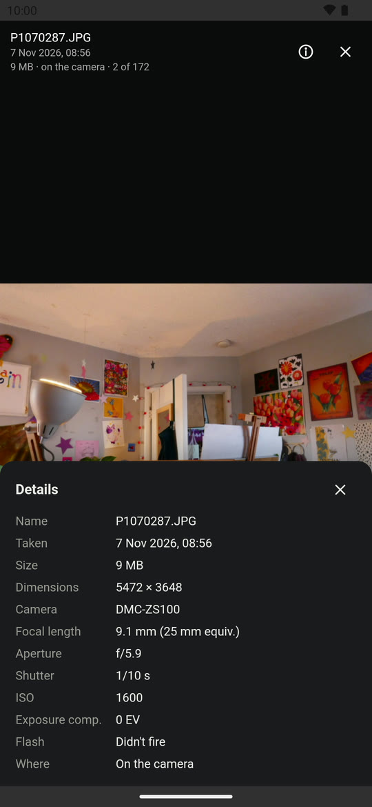 |
| **Selection**: long-press/drag, per day, select all | 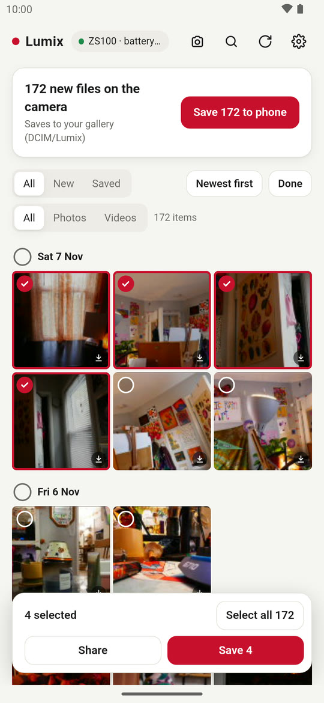 | 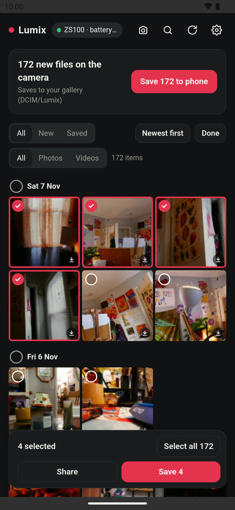 |
| **Background saving**: progress and Cancel in a notification | 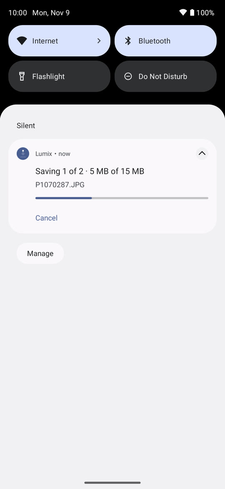 | 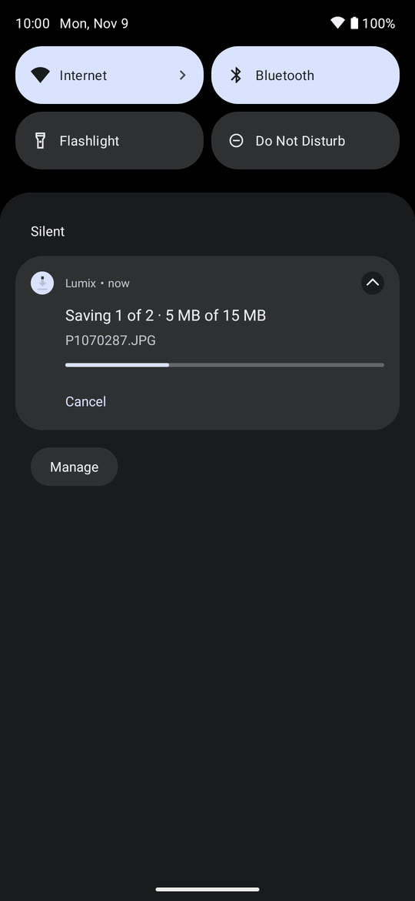 |
| **Remote**: live view, shutter, zoom, photo/video | 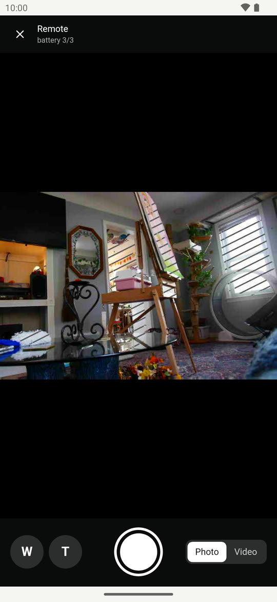 | 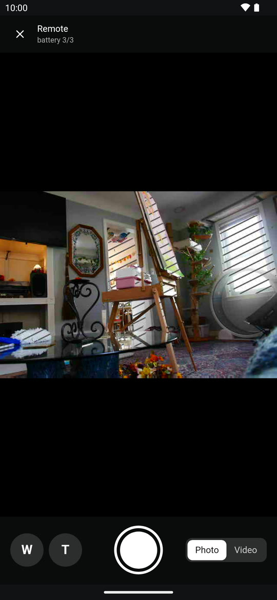 |

## Camera setup

Wi-Fi menu → Remote Shooting & View, and leave it on the waiting screen. Join your home network ("Via Network") or use the
camera's own hotspot (`192.168.54.1`). The app finds the camera by itself; the address can also be set in Settings.

## Install

Download `lumix-<version>.apk` from [Releases](../../releases) and install it. Updates install over the old app only if signed
with the same key.

## Build

```sh
git clone --recurse-submodules https://github.com/CameronChambers93/lumix-lux-android.git
npm ci && sh build.sh        # Node 22, JDK 21, Android SDK 36 → dist/lumix.apk
```

Create your own signing key in `keystore/` (gitignored) first and add `keystore/keystore.properties` (see
`android/app/build.gradle`). The page is shared with the iOS app and lives in `core/ui/`. Testing: `tools/TESTING.md`.

History: split from [lumix-zs100-controller](https://github.com/CameronChambers93/lumix-zs100-controller) with history kept.
